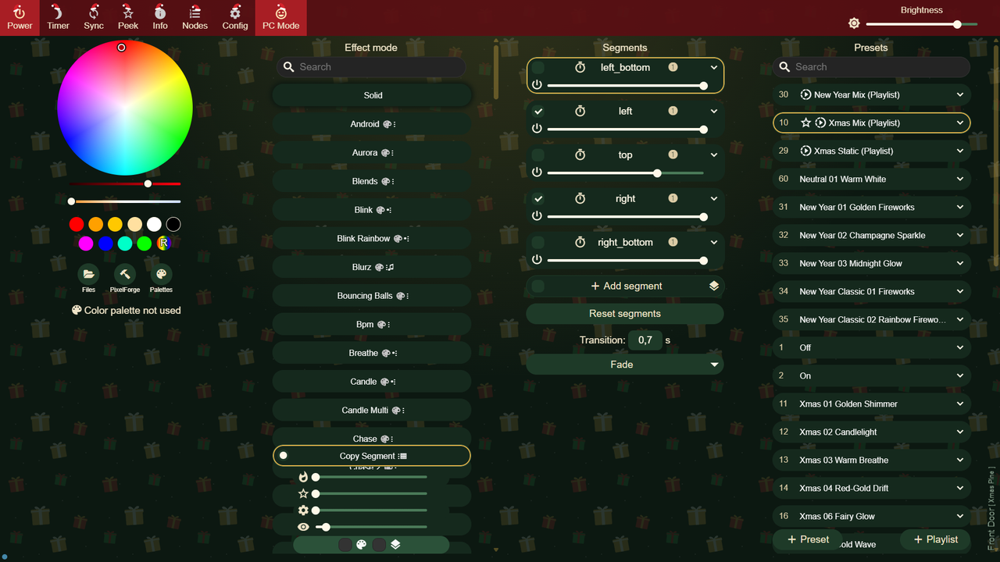
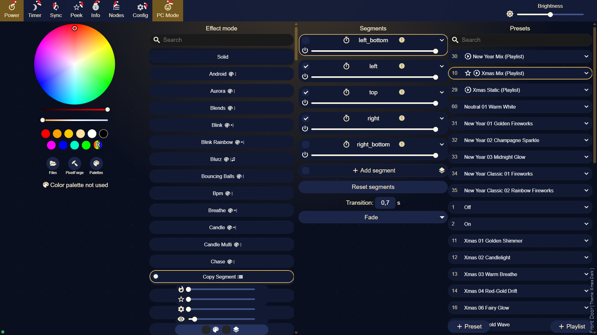

<div align="center">

<h1>WLED Community Themes</h1>

<p>Custom skins for the <a href="https://github.com/wled/WLED">WLED</a> web interface.<br>
One CSS file, a new look on desktop and a better, more readable layout on mobile.</p>

<p>
  <a href="#themes"><strong>Browse themes</strong></a>
  ·
  <a href="#installation">Install</a>
  ·
  <a href="https://github.com/itCarl/WLED-Community-Themes/issues">Report a bug</a>
  ·
  <a href="https://github.com/itCarl/WLED-Community-Themes/issues">Request a theme</a>
</p>

<p>
  <a href="https://github.com/itCarl/WLED-Community-Themes/blob/development/package.json"></a>
  <a href="https://github.com/wled/WLED"></a>
  <a href="https://sass-lang.com/"></a>
  <a href="LICENSE"></a>
  <br>
  <a href="https://github.com/itCarl/WLED-Community-Themes/commits/development"></a>
  <a href="https://github.com/itCarl/WLED-Community-Themes/issues"></a>
  <a href="https://github.com/itCarl/WLED-Community-Themes/stargazers"></a>
  <a href="#contributing"></a>
</p>

<table>
  <tr>
    <td></td>
    <td></td>
  </tr>
  <tr>
    <td align="center"><b>Xmas Pine</b></td>
    <td align="center"><b>Xmas Red</b></td>
  </tr>
  <tr>
    <td></td>
    <td></td>
  </tr>
  <tr>
    <td align="center"><b>Xmas Snow</b></td>
    <td align="center"><b>Xmas Dark</b></td>
  </tr>
</table>

</div>

<details>
  <summary>Table of contents</summary>

- [About](#about)
- [Themes](#themes)
- [Installation](#installation)
- [Build from source](#build-from-source)
- [Write your own theme](#write-your-own-theme)
- [Roadmap](#roadmap)
- [Contributing](#contributing)
- [License](#license)
- [Acknowledgments](#-acknowledgments)

</details>

## About

WLED lets you replace the look of its web app with your own `skin.css`. This repository collects
ready-made skins, written in Sass so colours are easy to change.

**Made for phones too.** Besides the new colours, every theme improves the mobile layout of
stock WLED: lists use the full screen width instead of 280px, long preset and effect names are no
longer cut off at 170px, and segment sliders span the whole row instead of 230px. More readable
on small screens, easier to tap. Each theme folder shows a mobile screenshot.

## Themes

| Theme | Colours | Look | Download |
| --- | --- | --- | --- |
| [Xmas Pine](themes/xmas-pine) |  | Pine green, deep red bars, gold selection, snow dots, Santa hats | [`theme-xmas-pine.css`](themes/xmas-pine/theme-xmas-pine.css) |
| [Xmas Red](themes/xmas-red) |  | Candy red, fir green bars, white accents, Santa hats | [`theme-xmas-red.css`](themes/xmas-red/theme-xmas-red.css) |
| [Xmas Snow](themes/xmas-snow) |  | Light theme: snow white and ice blue, red bars, Santa hats | [`theme-xmas-snow.css`](themes/xmas-snow/theme-xmas-snow.css) |
| [Xmas Dark](themes/xmas-dark) |  | Midnight blue with gold accents, Santa hats | [`theme-xmas-dark.css`](themes/xmas-dark/theme-xmas-dark.css) |
| [Rainbow Static](themes/rainbow-static) |  | Rainbow-striped bars, rounded controls | [`theme-rainbow-static.css`](themes/rainbow-static/theme-rainbow-static.css) |
| [Base](themes/base) |  | Starting point for your own theme | [`theme.css`](themes/base/theme.css) |

Colours of the Xmas themes, left to right: background, list entries, bars, accent, text.
Each theme folder has a README with desktop and mobile screenshots.

## Installation

1. Download the `.css` file of a theme from the table above.
2. Upload it to your controller as **`/skin.css`**: open `http://<wled-ip>/edit` and use the file
   upload, or from a shell:
   ```bash
   curl -F "data=@theme-xmas-pine.css;filename=/skin.css" http://<wled-ip>/upload
   ```
   On Windows in Git Bash, put `MSYS_NO_PATHCONV=1` in front of the command, otherwise the file name gets mangled.
3. In the WLED app open **Config → User Interface**, tick **Enable custom CSS**, save and reload.

> [!NOTE]
> "Enable custom CSS" is stored per browser. Turn it on once on every phone and PC.
> To go back to the stock look, untick it or upload an empty `skin.css`.

> [!TIP]
> Skins change the main app (Colors, Effects, Segments, Presets). The settings pages always use
> WLED's built-in style and cannot be themed.

## Build from source

Only needed if you change a theme or write your own.

**Prerequisites:** [Node.js](https://nodejs.org/)

```bash
git clone https://github.com/itCarl/WLED-Community-Themes.git
cd WLED-Community-Themes
npm install     # installs Sass locally
npm run dev     # compiles every themes/<name>/*.scss to a .css next to it
```

Compile a single theme:

```bash
npx sass --no-source-map --style=compressed --load-path=shared themes/xmas-pine/theme-xmas-pine.scss themes/xmas-pine/theme-xmas-pine.css
```

## Write your own theme

1. Copy a theme folder, e.g. `themes/xmas-pine` to `themes/my-theme`, and rename the `.scss` file.
2. Set your colours. The Xmas themes show the pattern: set a few `$x-…` variables, then
   `@import 'xmas/xmas';`. For a theme from scratch, override WLED's colour variables
   (`--c-1` … `--c-f`, `--c-tb`, …) on `html:root` with `!important`, because WLED sets them at runtime.
3. Add the shared parts you want:
   - `@import 'base/mobile';` - readable lists, preset names and sliders on small screens
   - `@import 'xmas/santa-hats';` - Santa hats on the tab icons
4. Run `npm run dev`, upload the result and check the Effects, Segments and Presets tabs on a phone and a PC.
5. Add `desktop.png` (1280×720) and `mobile.png` (390×844) screenshots of the Effects tab and a short README.

## Roadmap

- [x] Christmas themes (Pine, Red, Snow, Dark)
- [x] Shared fixes for small screens
- [ ] New Year theme (black and gold)
- [ ] AMOLED theme (pure black)
- [ ] Popular colour schemes (Catppuccin, Nord, Dracula)
- [ ] Wall tablet / kiosk theme with large buttons

Ideas are welcome, open an [issue](https://github.com/itCarl/WLED-Community-Themes/issues).

## Contributing

New themes and fixes are welcome.

1. Fork the repository
2. Create a branch (`git checkout -b feature/my-theme`)
3. Add your theme folder: `.scss` source, compiled `.css`, README, desktop and mobile screenshots
4. Commit and push, then open a pull request against `development`

## License

Released under the MIT License. See [`LICENSE`](LICENSE).

## 🙏 Acknowledgments

- 💡 [WLED](https://github.com/wled/WLED) by Christian Schwinne (Aircoookie) and all contributors ❤️
