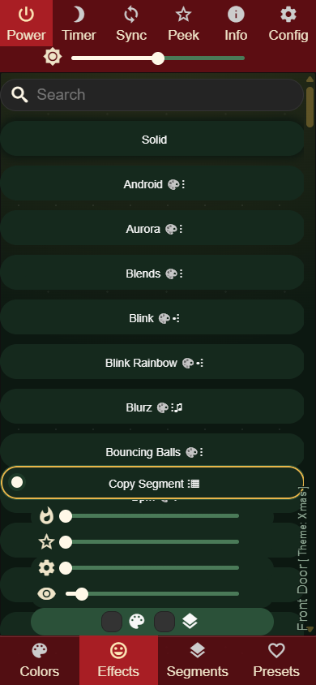
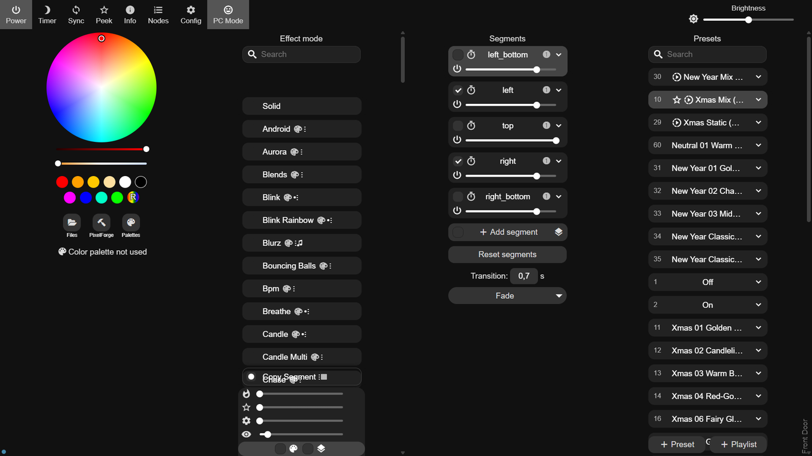

# WLED Community Themes

Custom skins for the [WLED](https://github.com/wled/WLED) web interface. Upload one CSS file to your
controller and the WLED app gets a new look, plus a layout that stays readable on phones.

<table>
  <tr>
    <th>Xmas - desktop</th>
    <th>Xmas - mobile</th>
  </tr>
  <tr>
    <td></td>
    <td></td>
  </tr>
  <tr>
    <th>Rainbow Static - desktop</th>
    <th>Rainbow Static - mobile</th>
  </tr>
  <tr>
    <td></td>
    <td></td>
  </tr>
</table>

## Themes

| Theme | Description | Download |
| --- | --- | --- |
| [Xmas](themes/xmas) | Pine green surfaces, deep red bars, warm white text, gold selection, faint snow dots. Wide, readable lists on phones. | [`theme-xmas.css`](themes/xmas/theme-xmas.css) |
| [Rainbow Static](themes/rainbow-static) | Rainbow-striped top and bottom bars, rounded buttons and list entries. | [`theme-rainbow-static.css`](themes/rainbow-static/theme-rainbow-static.css) |
| [Base](themes/base) | Starting point for your own theme: rounded corners and a rainbow highlight. | [`theme.css`](themes/base/theme.css) |

Each theme folder has its own README with screenshots, the ready-to-upload `.css` and the `.scss` source.

## Install

1. Download the `.css` file of a theme.
2. Upload it to your controller as **`/skin.css`**, either in the file editor at `http://<wled-ip>/edit`
   or from a shell:
   ```bash
   curl -F "data=@theme-xmas.css;filename=/skin.css" http://<wled-ip>/upload
   ```
   On Windows in Git Bash, put `MSYS_NO_PATHCONV=1` in front, otherwise the file name gets mangled.
3. In the WLED app open **Config → User Interface**, tick **"Enable custom CSS"**, save and reload.

The "Enable custom CSS" switch is stored in the browser, so turn it on once on every phone and PC.
To go back to the stock look, untick it or upload an empty `skin.css`.

**Good to know**
- Themes change the main app (Colors, Effects, Segments, Presets). The settings pages always use
  WLED's built-in style, a skin cannot change them.
- Tested with WLED 16.0.

## Build from source

Only needed if you change a theme or write your own. Requires [Node.js](https://nodejs.org/).

```bash
npm install     # installs sass locally
npm run dev     # compiles every themes/<name>/*.scss to a .css next to it
```

Compile a single theme:

```bash
npx sass --no-source-map --style=compressed --load-path=shared themes/xmas/theme-xmas.scss themes/xmas/theme-xmas.css
```

## Write your own theme

1. Copy a theme folder, e.g. `themes/xmas` to `themes/my-theme`, and rename the `.scss` file.
2. Change the colours. WLED sets its colour variables (`--c-1` ... `--c-f`, `--c-tb`, ...) at runtime,
   so override them on `html:root` with `!important`.
3. Keep phones in mind: `@import 'base/mobile';` pulls in the shared fixes for small screens.
   Stock WLED caps lists at 280px, preset names at 170px and segment sliders at 230px.
4. Run `npm run dev`, upload the result, check the Effects, Segments and Presets tabs on a phone and a PC.
5. Add `desktop.png` and `mobile.png` screenshots and a short README to the folder.

### Project layout

```text
themes/
  xmas/              theme-xmas.scss, theme-xmas.css, README.md, desktop.png, mobile.png
  rainbow-static/
  base/
shared/              partials, not compiled on their own
  base/_mobile.scss  readable lists and sliders on small screens
  utilities/         colour variables and mixins
```

## Contributing

New themes and fixes are welcome. Open a pull request with the theme folder (source, compiled CSS,
README, desktop and mobile screenshots).

## Credits

Thanks to Christian Schwinne (Aircoookie) and all contributors for creating [WLED](https://github.com/wled/WLED).

Released under the [MIT License](LICENSE).
