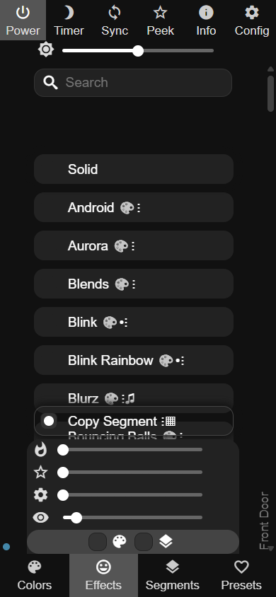

# Welcome WLED community themes! 🌈

Give your WLED installation a new customized look with these Themes

## You don't know what **WLED** is?! 😱
Go! check out _WLED_ [here](https://github.com/Aircoookie/WLED) now!

# ⚙️ Features

- xx Themes
- fun new styles for your _WLED_ project
- easy installation process


# 🎨 Themes

<table>
  <tr>
    <th>Xmas - desktop</th>
    <th>Xmas - mobile</th>
  </tr>
  <tr>
    <td></td>
    <td></td>
  </tr>
  <tr>
    <th>Rainbow Static - desktop</th>
    <th>Rainbow Static - mobile</th>
  </tr>
  <tr>
    <td></td>
    <td></td>
  </tr>
</table>

Ready-to-upload CSS lives in [`compiled/`](compiled), the SCSS sources in [`src/`](src).

| Theme | Ready to upload | Source | Look |
| --- | --- | --- | --- |
| Xmas | [`compiled/theme-xmas.css`](compiled/theme-xmas.css) | [`src/theme-xmas.scss`](src/theme-xmas.scss) | pine green surfaces, deep red bars, warm white text, gold selection, faint snow dots; wide, left-aligned lists so long preset names stay readable on phones |
| Rainbow Static | [`compiled/theme-rainbow-static.css`](compiled/theme-rainbow-static.css) | [`src/theme-rainbow-static.scss`](src/theme-rainbow-static.scss) | rainbow top/bottom bars, rounded controls |
| Base | [`compiled/theme.css`](compiled/theme.css) | [`src/theme.scss`](src/theme.scss) | rounded corners and rainbow selection; picks a theme via `@import` |

# 🎈 Installation

Yah, it is as simple as the following 4 steps

1. Download a _.css_ theme file
2. (If you wish to change something, you can do so)
3. Upload the theme/skin to your device that runs _WLED_
4. Done.

# 🛠️ Build from source

Only needed if you change a theme or write your own. You need [Node.js](https://nodejs.org/).

```bash
npm install          # installs sass locally
npm run dev          # compiles every src/*.scss to compiled/*.css (compressed, no source maps)
```

Compile a single theme:

```bash
npx sass --no-source-map --style=compressed src/theme-xmas.scss compiled/theme-xmas.css
```

Files starting with `_` are partials; they are not compiled on their own:
- `src/utilities/` - shared variables and mixins
- `src/base/_mobile.scss` - readable lists on phones and small screens (wide lists, full-width, left-aligned preset names). Add it to any theme with `@import 'base/mobile';` and tune it with `$mobile-list-max` (default `560px`) before the import.

Tips for writing a theme:
- WLED sets its colour variables (`--c-1` ... `--c-f`, `--c-tb`, ...) at runtime, so override them on `html:root` with `!important`.
- Stock WLED caps the lists at `280px` (`#pcont`, `#fx`, `#palw`, `#segcont`, ...) and preset names at `width: 170px` (`.pname`).

# 📤 Upload to WLED

1. Open `http://<wled-ip>/edit` and upload the `.css` file as **`/skin.css`**, or from a shell:
   ```bash
   curl -F "data=@compiled/theme-xmas.css;filename=/skin.css" http://<wled-ip>/upload
   ```
   (Git Bash on Windows: prefix with `MSYS_NO_PATHCONV=1`, otherwise the file name gets mangled.)
2. In the WLED UI: **Config → User Interface → "Enable custom CSS"**, save, reload.
   This switch is stored per browser, so enable it once on every phone/PC.

If you came up with a really cool new Theme/Skin idea feel free to contribute to this repository so that others can use it as well 😄

# ❤️‍🔥 Other
Big thanks to Christian Schwinne 'Aircookie' for creating _WLED_.
