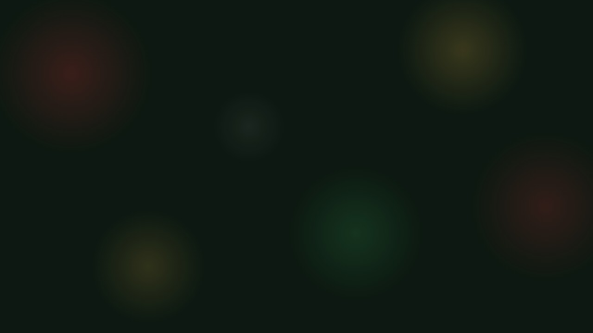
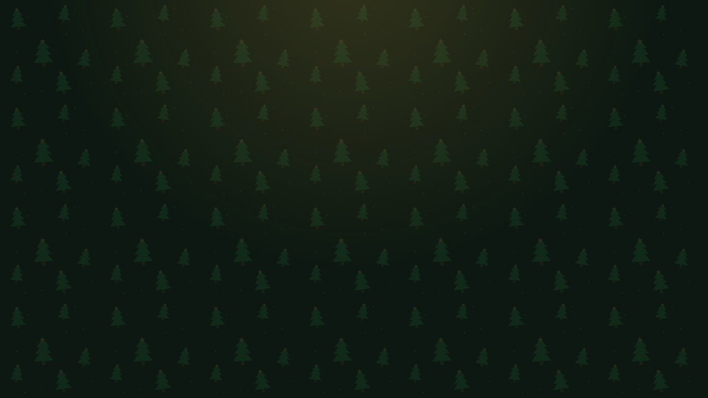
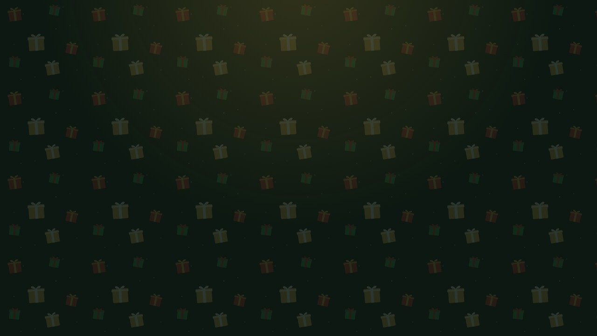
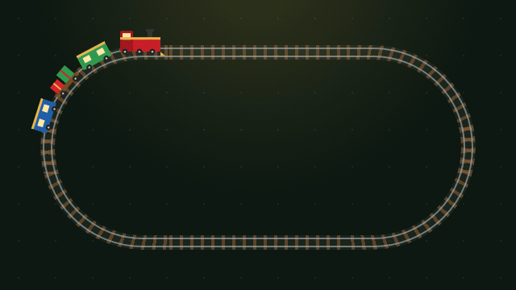

# Xmas backgrounds

Every Xmas theme can use any of these backgrounds. Pick one by setting `$x-background`
at the top of the theme's `.scss` file, then run `npm run dev`:

```scss
$x-name: "Xmas Pine";
$x-background: gifts;
```

Screenshots show the background alone, in the Xmas Pine colours; animated backgrounds are shown as GIF. The size is the compiled
Xmas Pine theme with that background (uncompressed / gzipped), so you can judge what a weak
controller or an old phone has to load.

| Background | Option | Animated | Size |
| --- | --- | --- | --- |
|  | `snow-dots` (default)<br>Faint snow dots and a warm glow at the top. | no | 4.3 KB / 1.4 KB |
|  | `snowfall`<br>The snow dots, slowly falling. | yes | 4.5 KB / 1.5 KB |
|  | `bokeh`<br>Large, soft out-of-focus Christmas lights. | no | 4.4 KB / 1.4 KB |
|  | `tree-pattern`<br>Tileable texture of little fir trees with a gold star. | no | 6.0 KB / 1.8 KB |
|  | `gifts`<br>Tileable texture of wrapped presents with bows. | no | 7.3 KB / 1.8 KB |
|  | `train`<br>A little Christmas train circling a track around the screen. | yes | 11.4 KB / 2.4 KB |
| | `own-image`<br>Keeps the background image from WLED's UI settings, dimmed and tinted with the theme colour. | no | 3.9 KB / 1.3 KB |

**Good to know**
- Animated backgrounds keep the browser busy. On old phones or tablets pick a static one.
  Both animations stop when the system setting "reduce motion" is on.
- The train needs a current browser (CSS `offset-path`, Chrome/Edge 116+, Firefox 122+, Safari 16+).
- All backgrounds are drawn with CSS and inline SVG, no image files are loaded from the controller.
