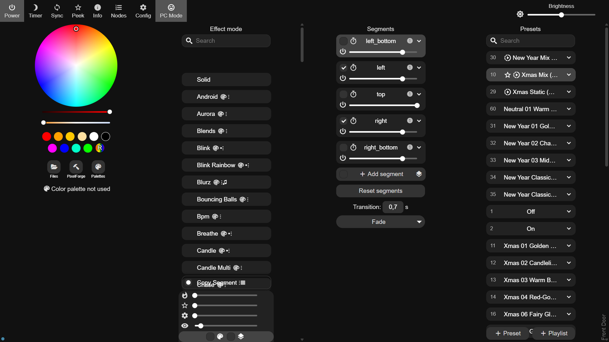
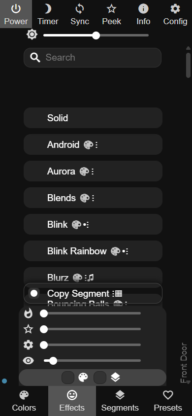

# Rainbow Static

Rainbow-striped top and bottom bars with rounded buttons, inputs and list entries.
Stock WLED colours otherwise.

| Desktop | Mobile |
| --- | --- |
|  |  |

## Files

- [`theme-rainbow-static.css`](theme-rainbow-static.css) - ready to upload
- [`theme-rainbow-static.scss`](theme-rainbow-static.scss) - source

## Install

Upload `theme-rainbow-static.css` as `/skin.css` and enable **Config → User Interface → "Enable custom CSS"**
(see the main [README](../../README.md#-upload-to-wled)).
