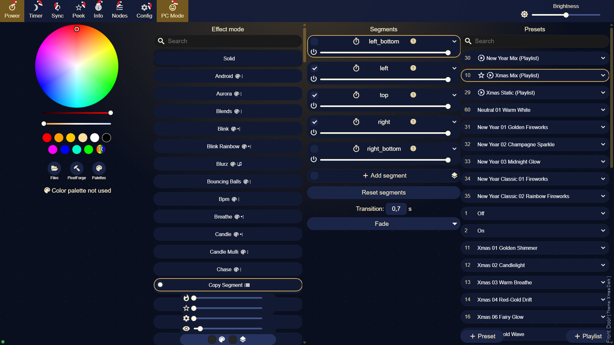
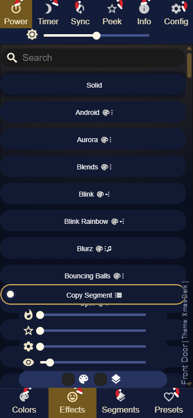

# Xmas Dark

Midnight blue surfaces, gold active tab, gold frame around the selected entry and a warm glow at the top.

Santa hats sit on the tab icons, each one a little different. Includes the shared fixes for small
screens: wide lists, full-width preset names and full-width segment sliders.

| Desktop | Mobile |
| --- | --- |
|  |  |

## Files

- [`theme-xmas-dark.css`](theme-xmas-dark.css) - ready to upload
- [`theme-xmas-dark.scss`](theme-xmas-dark.scss) - source; the colours are the `$x-…` variables at the top

Don't want the hats? Remove `@import 'xmas/santa-hats';` from the `.scss` and run `npm run dev`.

## Install

Upload `theme-xmas-dark.css` as `/skin.css` and enable **Config → User Interface → Enable custom CSS**
(see the main [README](../../README.md#installation)).
