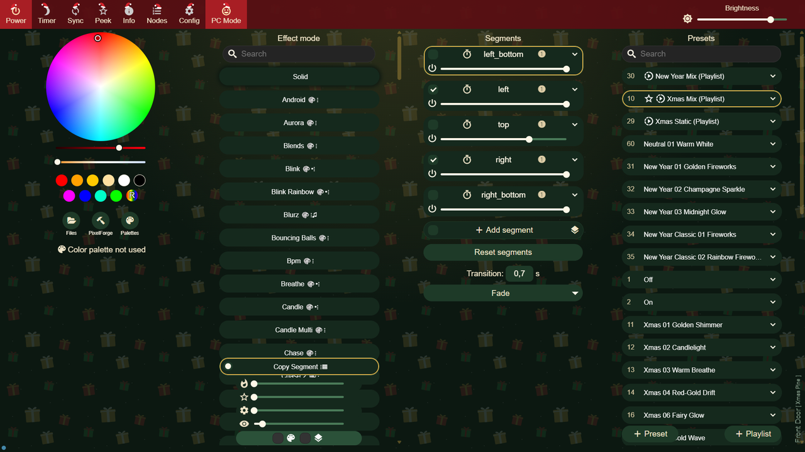
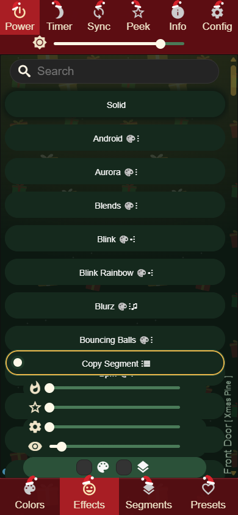

# Xmas Pine

Pine green surfaces, deep red top and bottom bars, warm white text, a gold frame around the selected entry and a subtle pattern of wrapped presents in the background.

Santa hats sit on the tab icons, each one a little different. Includes the shared fixes for small
screens: wide lists, full-width preset names and full-width segment sliders.

| Desktop | Mobile |
| --- | --- |
|  |  |

## Colours

| Role | Colour |
| --- | --- |
| Background | `#0c1811` |
| List entries | `#15291d` |
| Bars | `#5c0c12` |
| Accent | `#e8b54a` |
| Text | `#fff8e8` |

## Files

- [`theme-xmas-pine.css`](theme-xmas-pine.css) - ready to upload
- [`theme-xmas-pine.scss`](theme-xmas-pine.scss) - source; the colours are the `$x-…` variables at the top

Don't want the hats? Remove `@import 'xmas/santa-hats';` from the `.scss` and run `npm run dev`.

## Install

Upload `theme-xmas-pine.css` as `/skin.css` and enable **Config → User Interface → Enable custom CSS**
(see the main [README](../../README.md#installation)).
