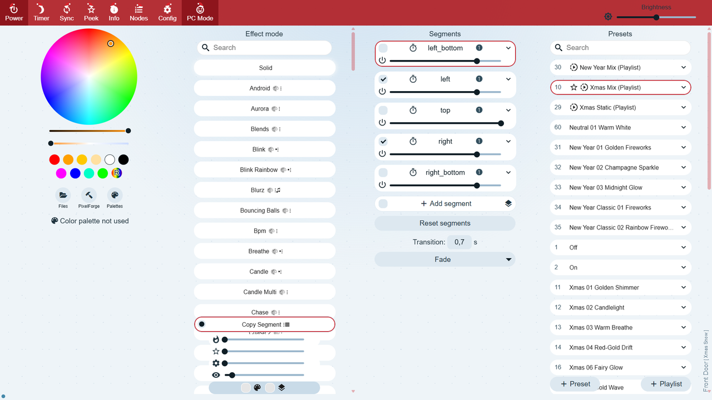
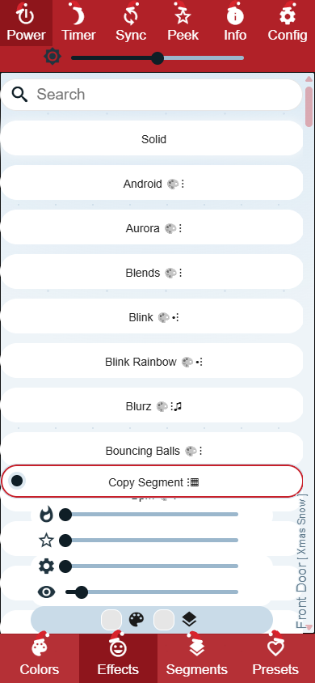

# Xmas Snow

Light theme: snow white and ice blue surfaces, red top and bottom bars with white labels, red frame around the selected entry. Good in bright rooms and daylight.

Santa hats sit on the tab icons, each one a little different. Includes the shared fixes for small
screens: wide lists, full-width preset names and full-width segment sliders.

| Desktop | Mobile |
| --- | --- |
|  |  |

## Colours

| Role | Colour |
| --- | --- |
| Background | `#eef4f8` |
| List entries | `#ffffff` |
| Bars | `#b02026` |
| Accent | `#c8202a` |
| Text | `#0f1e26` |

## Files

- [`theme-xmas-snow.css`](theme-xmas-snow.css) - ready to upload
- [`theme-xmas-snow.scss`](theme-xmas-snow.scss) - source; the colours are the `$x-…` variables at the top

Don't want the hats? Remove `@import 'xmas/santa-hats';` from the `.scss` and run `npm run dev`.

## Install

Upload `theme-xmas-snow.css` as `/skin.css` and enable **Config → User Interface → Enable custom CSS**
(see the main [README](../../README.md#installation)).
