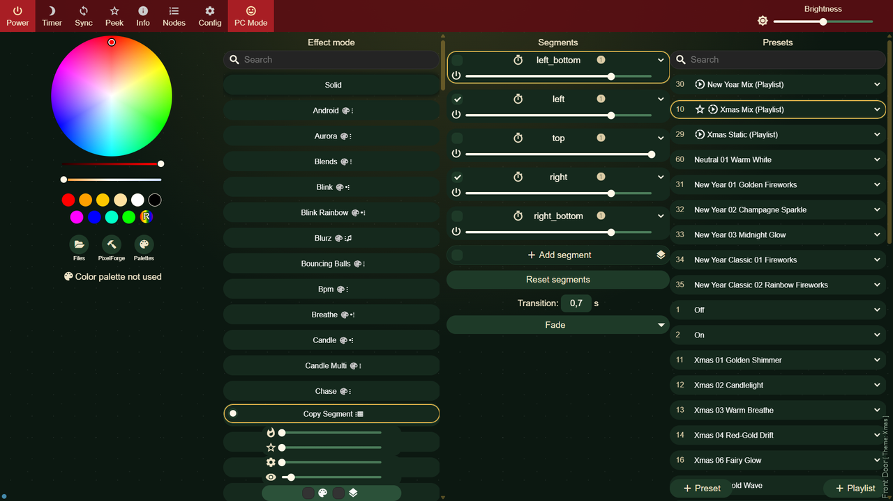
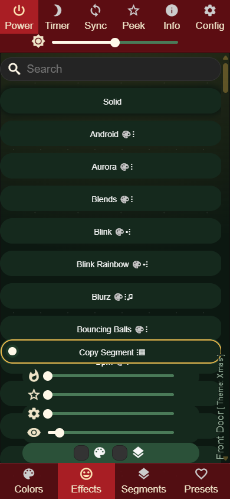

# Xmas

Christmas theme for the WLED web UI: pine green surfaces, deep red top and bottom bars,
warm white text, a gold frame around the selected entry and faint snow dots on the background.

Includes the shared mobile fixes (`shared/base/_mobile.scss`): wide lists, full-width
left-aligned preset names and full-width segment sliders, so long names stay readable on phones.

| Desktop | Mobile |
| --- | --- |
|  |  |

## Files

- [`theme-xmas.css`](theme-xmas.css) - ready to upload
- [`theme-xmas.scss`](theme-xmas.scss) - source; colours and list width are variables at the top

## Install

Upload `theme-xmas.css` as `/skin.css` and enable **Config → User Interface → "Enable custom CSS"**
(see the main [README](../../README.md#-upload-to-wled)).
